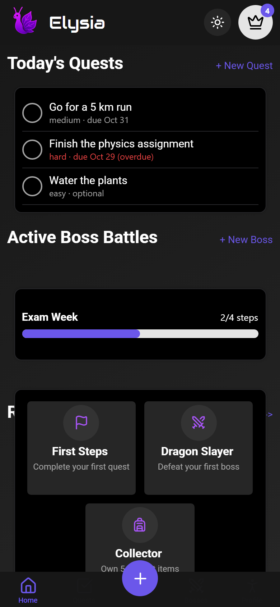
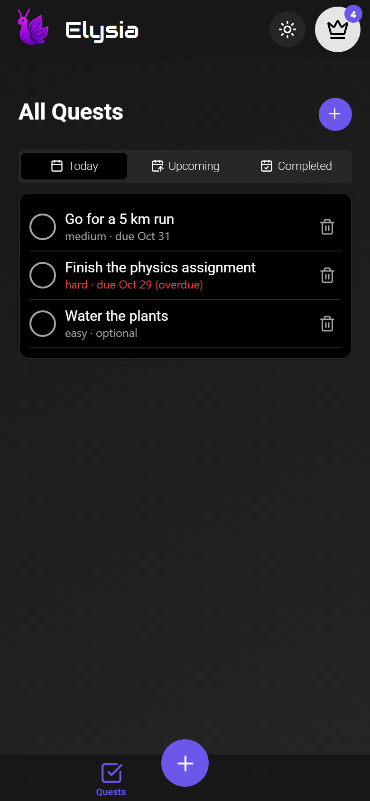
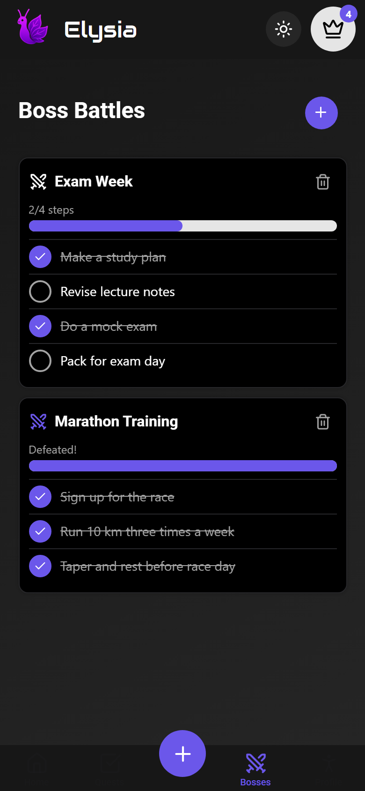
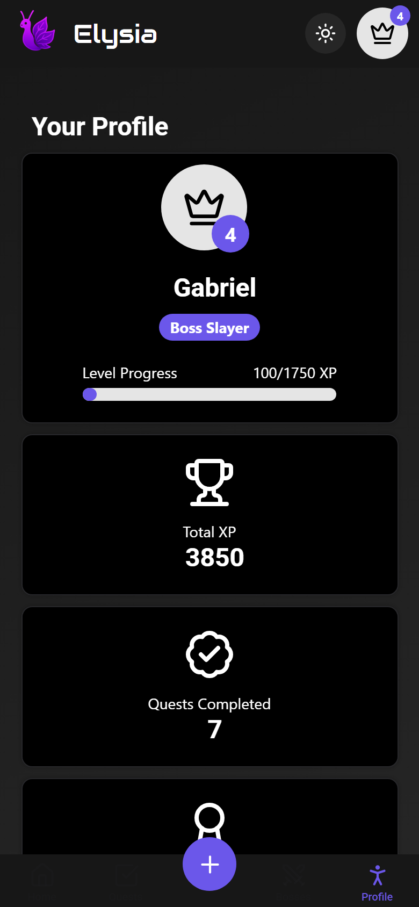
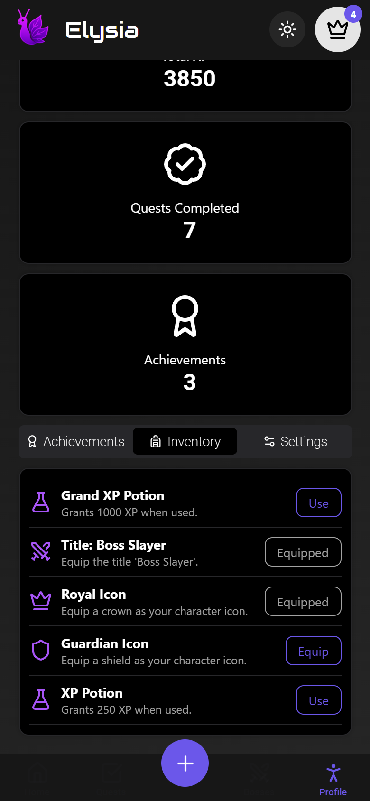
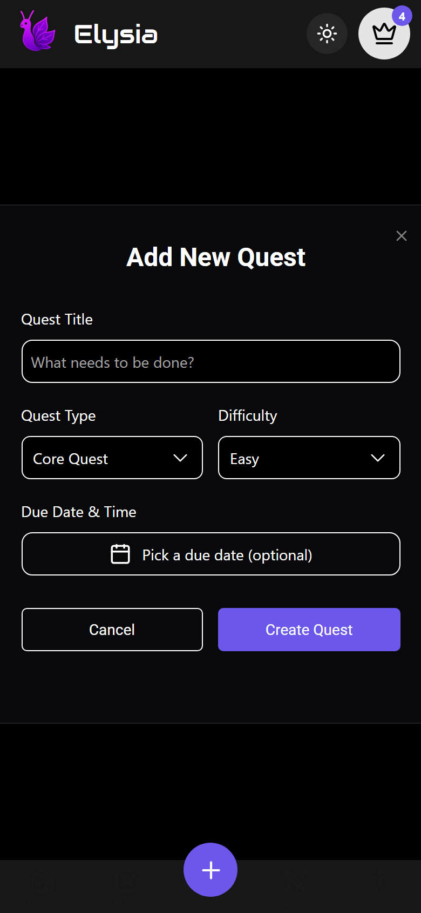

# Elysia

Elysia is a gamified to-do app. Tasks become **quests** with difficulties that
grant XP, bigger projects become **boss battles** broken into steps, and
progress unlocks levels, achievements and collectible items (XP potions,
profile icons, titles).

<table>
  <tr>
    <td></td>
    <td></td>
    <td></td>
  </tr>
  <tr>
    <td></td>
    <td></td>
    <td></td>
  </tr>
</table>

<sub>Screenshots were rendered from the web build of the app; light mode:
<a href="docs/screenshots/home-light.png">home-light.png</a>.</sub>

## Download / Install

Get `Elysia.apk` from the repo's [Releases page](../../releases/latest) —
builds on `main` publish a release asset named `Elysia.apk`. Builds from
other branches are available as the `Elysia-apk` workflow artifact.

To install, copy the APK to an Android phone and open it, allowing installs
from unknown sources when prompted. The APK is signed with the standard
Android debug key, so Play Protect may warn that the developer is unknown —
that's expected for a sideloaded build and it is not suitable for the Play
Store. Each new build installs as an update over the previous one.

The APK is built for `arm64-v8a` devices only.

## Repository layout

- `LevelUp/` — the mobile app (Expo SDK 58, expo-router, JavaScript).
- `db/` — the optional self-hosted backend (Express 5 + Mongoose + JWT auth).
- `shared/gameRules.js` — the game rules (XP, levels, loot, achievements) shared
  verbatim by the app and the server so both modes behave identically.
- `docker-compose.yml` — one-command self-hosted backend (MongoDB + API).
- `.github/workflows/android-apk.yml` — CI that builds and publishes the APK.

## Running the app

```bash
cd LevelUp
npm install
npx expo start
```

Then open it in a development build (`npx expo run:android`) or the release
APK — the app uses native modules (Reanimated, AsyncStorage), so a native
build is required. No backend is needed; local mode works fully offline.

### Local vs. server mode

The app works fully offline out of the box: all data lives on the device in
AsyncStorage (**local mode**). On first launch it asks for a display name and
you're in.

In **Profile → Settings → Data Mode** you can switch to **server mode** by
entering the URL of a self-hosted backend and registering/logging in. Server
mode authenticates with username + password (JWT). Data is *not* migrated when
switching between local and server mode — each mode has its own profile.

> Note: the Android release build allows plain `http://` to a self-hosted
> server on your LAN (`usesCleartextTraffic` is enabled via
> `expo-build-properties`), so no HTTPS setup is needed.

## Building the APK

CI is the supported route: `.github/workflows/android-apk.yml` builds the
release APK on `main` and publishes it as a GitHub Release asset.

To build locally you need JDK 17 and the Android SDK installed, then:

```bash
cd LevelUp
npx expo prebuild --platform android
android\gradlew.bat -p android assembleRelease   # or ./gradlew assembleRelease
```

On Windows the project must live at a short path (e.g. `C:\elysia\LevelUp`):
CMake/ninja object paths exceed the 260-character limit otherwise and the
native build fails.

## Self-hosting the server

### With Docker (recommended)

```bash
JWT_SECRET="a-long-random-string" docker compose up --build
```

This starts MongoDB and the API on port `3001`.

### Without Docker

You need a running MongoDB (local install, Docker, or Atlas).

```bash
cd db
npm install
cp .env.example .env   # fill in MONGODB_URI and JWT_SECRET
npm start              # listens on PORT (default 3001)
```

`JWT_SECRET` is required; the server refuses to start without it.

The API exposes `GET /api/health`, `POST /api/auth/register`,
`POST /api/auth/login`, and authenticated routes for profile, quests, bosses,
achievements and inventory. All game logic lives in `shared/gameRules.js`.

## Tests

```bash
node --test shared/        # game rules unit tests
cd db && npm test          # API tests (supertest + in-memory MongoDB)
cd LevelUp && npx jest --ci  # local store tests
```
